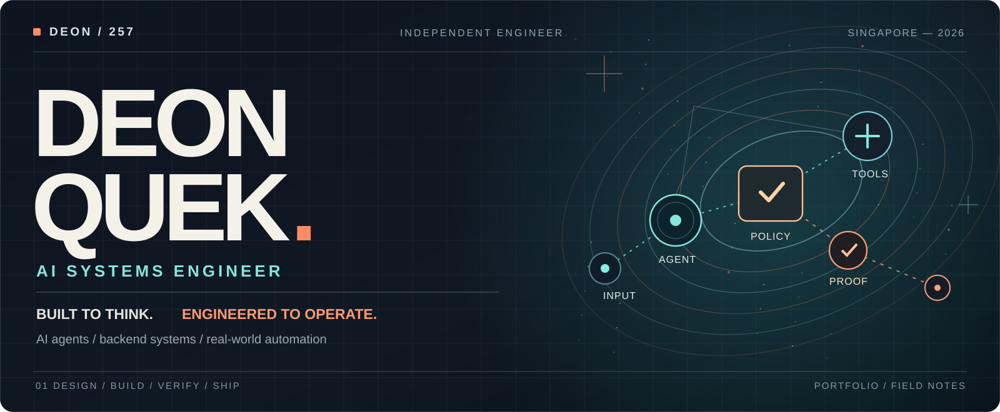
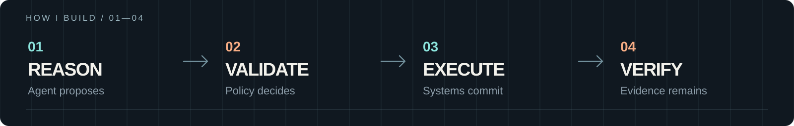

<!-- PORTFOLIO PREVIEW V3 · Created for joyboy257, review before merging. -->

  

  <a href="#selected-work"><strong>Selected work</strong></a>&nbsp;&nbsp; / &nbsp;&nbsp;
  <a href="#from-idea-to-production"><strong>Engineering approach</strong></a>&nbsp;&nbsp; / &nbsp;&nbsp;
  <a href="#also-in-the-lab"><strong>Open-source & experiments</strong></a>&nbsp;&nbsp; / &nbsp;&nbsp;
  <a href="https://www.linkedin.com/in/deonquek"><strong>LinkedIn</strong></a>&nbsp;&nbsp; / &nbsp;&nbsp;
  <a href="https://usemirai.app"><strong>Mirai ↗</strong></a>

  <strong>I build AI software that does more than generate an answer.</strong> 
  Agent runtimes, business integrations, distributed backends, evaluation and real-world automation. 
  Based in Singapore · Applied AI / Software Engineering / Forward-Deployed Engineering

---

## Selected work

**A few projects, different problems, one engineering philosophy:** make intelligent software useful, observable and dependable.

### 01 / Mirai — AI systems that can run a business workflow

<table>
<tr><td width="63%" valign="top">

**A multi-tenant AI business platform**, combining customer conversations, persistent agents, knowledge, integrations and developer tools.

**My work:** Founder and lead engineer. Architecture, backend, AI execution, tool authorization, tenant isolation, evaluation, product experience and delivery.

**The engineering problem:** LLMs can propose actions. The backend must still own permissions, business truth, durable writes, retries and audit.

**Proof, not just pitch:** A documented **July 2026 internal evaluation** completed 500/500 iterations, 49 governed tools and 201/201 active safety cases. Internal certification isn't a claim of external customer performance.

</td><td width="37%" valign="top">

**THE STACK**

`TypeScript` `Node.js` `PostgreSQL` `Redis` `Agents` `MCP` `Evals`

**EXPLORE**

[Architecture & engineering case study →](https://github.com/joyboy257/mirai-showcase)

[Product walkthrough →](https://usemirai.app/demo)

[Live product website →](https://usemirai.app)

</td></tr>
</table>

### 02 / Amelia Bot — forward-deployed automation, used by staff

<table>
<tr>
<td width="48%" valign="top">
  
</td>
<td width="52%" valign="top">

**A real staff-used production workflow**, built for a private professional-services client.

I translated an operational problem into a Telegram-based intake, file finalisation and AI enrichment workflow using **n8n, Google Drive, Sheets and PostgreSQL**.

Then I audited its failure modes: hidden state, duplicate events and application logic trapped inside automation nodes. A 69-case shadow replay passed with zero unexpected differences; a database-authoritative replacement slice is test-verified but **not deployed to production**.

**Why it matters:** You don't get to pause a client's business while you design a prettier architecture.

[See the production story →](https://github.com/joyboy257/joyboy257/tree/main/showcases/amelia-bot)

</td>
</tr>
</table>

### 03 / Amethyst — giving AI reliable company context

<table>
<tr>
<td width="52%" valign="top">

AI decisions are only as trustworthy as the information and authority behind them.

I designed and engineered a **governed company-intelligence system** that keeps provenance, source freshness, permissions, human approvals, controlled learning and rollback tied to the work an agent performs.

**My work:** Product architecture, backend contracts, policy/approval design, evaluations and recovery engineering.

**Boundary:** Protected internal production. External pilot and live provider writes are explicitly disabled until their release gates are met.

[Explore the case study →](https://github.com/joyboy257/amethyst-showcase)

</td>
<td width="48%" valign="top">
  
</td>
</tr>
</table>

Case-study visuals for private systems are either sanitized or labelled reconstructions. Public demo and test states are distinguished from customer production.

---

## Also in the lab

Two more sides of my engineering work: making agents understandable, and making generative systems playable.

<table>
<tr>
<td width="50%" valign="top">

<h3><a href="https://github.com/joyboy257/agentos">AgentOS ↗</a></h3>
<strong>Visual AI coworkers.</strong> A full-stack experiment in agent assembly, durable runs, governed tools, memory and operator-facing UX.  
<code>Next.js</code> <code>TypeScript</code> <code>PostgreSQL</code> 
Active product prototype, not a hosted production platform.
</td>
<td width="50%" valign="top">

<h3><a href="https://github.com/joyboy257/dreamcraft">DreamCraft ↗</a></h3>
<strong>Language to playable 3D worlds.</strong> Procedural worlds, game systems, browser physics and AI-assisted world generation.  
<code>TypeScript</code> <code>Three.js</code> <code>WebGL</code> 
Locally playable; live-provider and release work remain gated.
</td>
</tr>
</table>

More public code: **[Atlas](https://github.com/joyboy257/atlas)** (agent runtime, local alpha) · **[RustyIndex](https://github.com/joyboy257/rustyindex)** (retrieval, Rust/Python) · **[PokerAI](https://github.com/joyboy257/pokerai-public)** (reinforcement learning research)

## From idea to production

I care about the engineering that comes *after* a convincing prototype:

- **Authority:** who can make a change, and what decides whether it is permitted?
- **Durability:** what happens during retries, duplicates, restarts, and partial failure?
- **Verification:** how do we know a system did the right thing rather than just return a plausible message?
- **Ownership:** what exactly is implemented, tested, deployed, used, or still on the roadmap?

I use Python, TypeScript, SQL, Rust and C++ across projects. My everyday stack includes PostgreSQL, Redis, Docker, React / Next.js, Node.js, n8n, LLM tool calling, MCP, testing and evaluation systems.

## Currently building / Heidi

**Agents that can discover, coordinate and transact on a permissioned Southeast Asian merchant network.**

Heidi is a founder-led bet on personal agents and agent-to-merchant commerce. The private project is in **product specification and staged MVP development**. It is not presented as a shipped consumer platform.

---

<strong>Software should be capable. The systems around it should be trustworthy.</strong>  
<a href="https://www.linkedin.com/in/deonquek"><strong>Connect on LinkedIn</strong></a>
&nbsp;&nbsp;·&nbsp;&nbsp;
<a href="https://github.com/joyboy257?tab=repositories"><strong>Browse the code</strong></a>
&nbsp;&nbsp;·&nbsp;&nbsp;
<a href="https://github.com/joyboy257/mirai-showcase"><strong>Start with Mirai</strong></a>

<!-- This branch is preview-only. Live profile remains on main. -->
